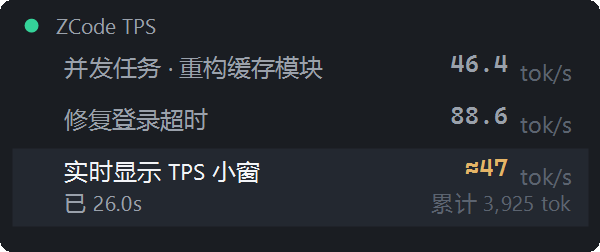

# ZCode TPS Monitor

[](https://github.com/xyhlzs/zcode-tps/actions/workflows/ci.yml)
[](LICENSE)
[](#环境与兼容性)

在 ZCode 界面**之外**开一个置顶小窗，实时显示模型生成速率（tok/s）。生成过程中
显示琥珀色 `≈` 估算让数字动起来，并发多个任务时各占一行并列显示，并跟随你当前
所在的会话。

<p align="center">
  
  &nbsp;&nbsp;
  
</p>

<p align="center"><sub>左：生成中——琥珀色 ≈ 估算（在飞）+ 计时 + 最近 40 次请求柱状图；<br>
右：并发多任务——活跃会话各占一行，在飞行置顶高亮，空闲行各显各的速率。<br>
截图由 <a href="tools/capture-overlay.ps1">tools/capture-overlay.ps1</a> 用合成数据生成。</sub></p>

English quickstart: Windows 10+ only. Add this repo as a plugin marketplace
(Plugin Marketplace → Add → Add Plugin Marketplace), install *ZCode TPS Monitor*,
then start any task: the overlay appears automatically. Configure via
`%LOCALAPPDATA%\ZCodeTpsMonitor\config.json` (UI language `auto` / `zh-CN` / `en-US`,
opacity, ZCode data home, window matching). Stop with `/tps stop`; uninstalling the
plugin stops and cleans up the watcher automatically.

---

## 安装

需要 Windows 10 及以上 + 系统自带的 Windows PowerShell 5.1。macOS / Linux 明确不支持
（小窗是 WinForms + user32 实现），hook 在非 Windows 上会静默退出，不影响会话。

1. 打开「插件市场 → 添加 → 添加插件市场」，粘贴本仓库地址。
2. 到「个人 → ZCode TPS 监控 → 安装」。
3. 新开一个任务，小窗随 `SessionStart` 自动出现。

本地开发时第 1 步粘贴的是本仓库目录（例如 `D:\dev\zcode-tps`）。详见
[zcode-tps/README.md § 安装](zcode-tps/README.md#安装)。

## 你会看到什么

深色小窗：大号等宽数字是唯一的主角，其余信息以小号灰字收在下方，
彩色只在表达状态时出现。速率数字分两层：**真值**（白/灰）是最近一次请求的
`outputTokens ÷ durationMs`；**估算**（琥珀色 `≈`）在生成过程中按当前消息字节
增量 × 标定系数实时推算，请求结束即被真值覆盖——没有依据时不出估算。

| 位置 | 含义 |
|---|---|
| 大号数字 | 在飞时优先显示 `≈` 估算（琥珀），空闲时显示最近一次请求的真值 |
| 左上圆点 | 绿色 = 正在生成或 2.5 秒内有新数据；红色 = 出错；灰色 = 空闲 |
| 右上角 | 生成中显示本次请求已进行的秒数；空闲/等待时显示当前会话 id 前 8 位 |
| 迷你柱状图 | 最近 40 次请求的真值速率，最右一根是当前值 |
| 元信息三行 | 左列：模型名、本轮 turn 输出 token、会话累计输出 token；右列：会话标题（取不到时退回已统计请求数）、平均速率、单次最高速率 |
| 多行模式 | 并发多任务时自动切换：最近 5 分钟活跃的会话各占一行（标题 + 各自速率），在飞行置顶高亮并带计时，上限 5 行折叠 `+N` |

窗口可拖动并记忆位置，默认 85% 不透明度（`-Opacity` 可调 0.3–1.0），鼠标悬停时右上角
淡入关闭钮。小窗跟随 ZCode 主窗口：ZCode 最小化时一并收起、恢复时弹回原位；ZCode 切到
后台时隐藏、回到前台自动恢复（不抢焦点）；ZCode 关闭时小窗自动退出。

完整的显示语义、会话跟随规则与实测边界见
[zcode-tps/README.md § 显示内容](zcode-tps/README.md#显示内容)。

## 配置

`%LOCALAPPDATA%\ZCodeTpsMonitor\config.json`（可选 JSON，改完重启监控生效）：

| 键 | 默认 | 说明 |
|---|---|---|
| `language` | `"auto"` | 界面语言：`auto` 跟随系统，或 `zh-CN` / `en-US` |
| `opacity` | `0.85` | 0.3–1.0 |
| `zcodeHome` | `""` | ZCode 数据目录；空 = `%USERPROFILE%\.zcode\cli` |
| `windowTitle` | `"ZCode"` | ZCode 主窗口匹配：窗口标题 |
| `windowProcess` | `"ZCode"` | ZCode 主窗口匹配：进程名（安装渠道不同可能不同） |
| `followForeground` | `true` | `false` = ZCode 不在前台时小窗也保持显示 |

命令行参数优先于配置文件，便于排查时临时覆盖。

## 启停与卸载

- `/tps start` / `/tps stop` 手动启停（`stop` 后守护进程在一个刷新周期内自己退出，
  不用杀进程）。
- 关闭窗口：悬停小窗点 `×`，下次 `SessionStart` 会再拉起。
- 卸载插件：在「设置 → 插件管理 → 已安装」里卸载即可。卸载后守护进程自动退出，并清掉
  `%LOCALAPPDATA%\ZCodeTpsMonitor` 下的状态文件。

## 环境与兼容性

| 项 | 要求 / 实测 |
|---|---|
| 操作系统 | Windows 10 及以上（macOS / Linux 不支持） |
| PowerShell | 5.1 及以上（系统自带）；脚本全部为 UTF-8 with BOM |
| Node.js（可选） | **≥ 22.5**（需要内置的 `node:sqlite`），用来显示会话标题、在飞估算与多会话并列。没有 Node 也完全能用：退回单会话卡片 + id 短码 + 在飞计时，速率真值等其余功能不受影响 |
| ZCode | 3.14.3.7762 上实测通过 |
| DPI | 100% / 200% 实测 |
| 受限语言模式（CLM） | 自动降级并标注「精简模式（系统策略限制）」；**未在真 CLM 环境验证过** |

小窗读的是 ZCode 的内部数据文件，没有官方 API 保证，ZCode 升级后功能可能失效（界面会
降级显示而不是崩溃），详见
[zcode-tps/README.md § 数据来源与已知限制](zcode-tps/README.md#数据来源与已知限制)。

## 文档索引

| 文档 | 内容 |
|---|---|
| [zcode-tps/README.md](zcode-tps/README.md) | 用户手册：显示语义、配置、会话跟随、手动运行、排查 |
| [CHANGELOG.md](CHANGELOG.md) | 版本变更记录 |
| [CONTRIBUTING.md](CONTRIBUTING.md) | 开发环境、测试、提交约定、发布清单 |

## 手动运行与自测

不装插件也能直接跑（在仓库根目录执行）：

```powershell
# 带窗口启动
powershell.exe -NoProfile -ExecutionPolicy Bypass -File zcode-tps\monitor\tps-monitor.ps1

# 无窗自检 10 秒，统计写到 %LOCALAPPDATA%\ZCodeTpsMonitor\status.json
powershell.exe -NoProfile -ExecutionPolicy Bypass -File zcode-tps\monitor\tps-monitor.ps1 -Headless -Seconds 10

# 会话跟随回归测试（6 个场景，退出码 0 即全部通过）
powershell.exe -NoProfile -ExecutionPolicy Bypass -File zcode-tps\tests\follow-test.ps1

# L3 估算 + 多会话数据层回归测试（4 个场景）
powershell.exe -NoProfile -ExecutionPolicy Bypass -File zcode-tps\tests\estim-test.ps1

# sidecar 数据契约测试（node >= 22.5）
node zcode-tps\tests\sidecar-test.mjs

# 重新生成上面的 README 截图
powershell.exe -NoProfile -ExecutionPolicy Bypass -File tools\capture-overlay.ps1
```

## 许可

[MIT](LICENSE) © 2026 xyhlzs
