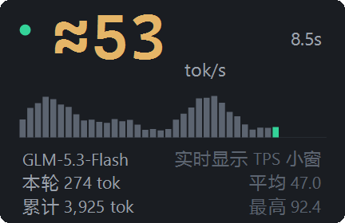
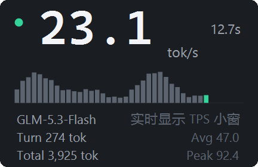

# ZCode TPS Monitor

[](https://github.com/xyhlzs/zcode-tps/actions/workflows/ci.yml)
[](LICENSE)
[](#环境与兼容性)

在 ZCode 界面**之外**开一个置顶小窗，实时显示模型生成速率（tok/s），并跟随你当前
所在的会话。

<p align="center">
  
  &nbsp;&nbsp;
  
</p>

<p align="center"><sub>生成中：绿点 + 在飞计时 + 亮白数字；柱状图是最近 40 次请求的速率。<br>
截图由 <a href="tools/capture-overlay.ps1">tools/capture-overlay.ps1</a> 用合成数据生成。</sub></p>

**English quickstart** — Windows 10+ only. Add this repo as a plugin marketplace
(**Plugin Marketplace → Add → Add Plugin Marketplace**), install *ZCode TPS Monitor*,
then start any task: the overlay appears automatically. Configure via
`%LOCALAPPDATA%\ZCodeTpsMonitor\config.json` (UI language `auto` / `zh-CN` / `en-US`,
opacity, ZCode data home, window matching). Stop with `/tps stop`; uninstalling the
plugin stops and cleans up the watcher automatically.

---

## 为什么是这个形态

ZCode 插件系统没有 UI 扩展点——插件只能贡献 skills / commands / hooks / MCP / agents，
manifest 里的 `channels`、`outputStyles`、`settings` 等字段是「记录但不执行」，所以
界面内嵌显示做不到。

这个插件走的是另一条路：用 `SessionStart` hook 拉起一个独立的 PowerShell 守护进程，
它读 ZCode 自己写到磁盘的文件算速率，画在一个无边框置顶小窗上。守护进程是单实例的
（命名互斥体），随 ZCode 主窗口的状态收放，卸载插件后自己退出并清理。

## 安装

需要 Windows 10 及以上 + 系统自带的 Windows PowerShell 5.1。macOS / Linux 明确不支持
（小窗是 WinForms + user32 实现），hook 在非 Windows 上会静默退出，不会报错打扰会话。

1. 打开 **插件市场 → 添加 → 添加插件市场**，粘贴本仓库地址。
2. 到 **个人 → ZCode TPS 监控 → 安装**。
3. 新开一个任务，小窗随 `SessionStart` 自动出现，无需任何手工步骤。

本地开发时第 1 步粘贴的是本仓库目录（例如 `D:\dev\zcode-tps`）。详见
[zcode-tps/README.md § 安装](zcode-tps/README.md#安装)。

## 你会看到什么

深色小窗，「数字即界面」：大号等宽数字是唯一的主角，其余信息以小号灰字收在下方，
彩色只在表达状态时出现。

| 位置 | 含义 |
|---|---|
| 大号数字 | 最近一次模型请求的速率 = `outputTokens ÷ durationMs`。在飞时亮白，空闲时降为灰色 |
| 左上圆点 | 绿色 = 正在生成或 2.5 秒内有新数据；红色 = 出错；灰色 = 空闲 |
| 右上角 | 生成中显示本次请求已进行的秒数；空闲/等待时显示当前会话 id 前 8 位 |
| 迷你柱状图 | 最近 40 次请求的速率，最右一根是当前值 |
| 元信息三行 | 左列：模型名、本轮 turn 输出 token、会话累计输出 token；右列：会话标题（取不到时退回已统计请求数）、平均速率、单次最高速率 |

窗口可拖动并记忆位置，默认 85% 不透明度（`-Opacity` 可调 0.3–1.0），鼠标悬停时右上角
淡入关闭钮。小窗跟随 ZCode 主窗口：ZCode 最小化时一并收起、恢复时弹回原位；ZCode 切到
后台时隐藏、回到前台自动恢复（不抢焦点）；ZCode 关闭时小窗自动退出。

完整的显示语义、会话跟随规则与实测边界见
[zcode-tps/README.md § 显示内容](zcode-tps/README.md#显示内容)。

## 配置

`%LOCALAPPDATA%\ZCodeTpsMonitor\config.json`（可选 JSON，改完重启监控生效）：

| 键 | 默认 | 说明 |
|---|---|---|
| `language` | `"auto"` | 界面语言：`auto` 跟随系统，或 `zh-CN` / `en-US` |
| `opacity` | `0.85` | 0.3–1.0 |
| `zcodeHome` | `""` | ZCode 数据目录；空 = `%USERPROFILE%\.zcode\cli` |
| `windowTitle` | `"ZCode"` | ZCode 主窗口匹配：窗口标题 |
| `windowProcess` | `"ZCode"` | ZCode 主窗口匹配：进程名（安装渠道不同可能不同） |
| `followForeground` | `true` | `false` = ZCode 不在前台时小窗也保持显示 |

命令行参数优先于配置文件，便于排查时临时覆盖。

## 启停与卸载

- `/tps start` / `/tps stop` 手动启停（`stop` 写哨兵文件，守护进程在一个刷新周期内
  自己退出，不用杀进程）。
- 关闭窗口：悬停小窗点 `×`，下次 `SessionStart` 会再拉起。
- **卸载插件**：在 **设置 → 插件管理 → 已安装** 里卸载即可。守护进程每 2 秒检查一次
  插件目录，目录消失后自动退出并清掉 `%LOCALAPPDATA%\ZCodeTpsMonitor` 下的状态文件。

## 环境与兼容性

| 项 | 要求 / 实测 |
|---|---|
| 操作系统 | Windows 10 及以上（macOS / Linux 不支持） |
| PowerShell | 5.1 及以上（系统自带）；脚本全部为 UTF-8 with BOM |
| Node.js（可选） | **≥ 22.5**（需要内置的 `node:sqlite`），用来显示会话标题。没有 Node 也完全能用：元信息首行右列退回显示已统计请求数，速率等其余功能不受影响 |
| ZCode | 3.14.3.7762 上实测通过（见 [PORTABILITY.md § 3 验收矩阵](zcode-tps/PORTABILITY.md#3-验收矩阵)） |
| DPI | 100% / 200% 实测；按 `DpiX / 96` 缩放并做 PER_MONITOR_AWARE_V2 |
| 受限语言模式（CLM） | 自动降级并标注「精简模式（系统策略限制）」；**未在真 CLM 环境验证过** |

会话标题来自 ZCode 的 `db.sqlite`（`session` 表的 `title` 列），而 PowerShell 5.1 没有
SQLite provider，所以标题由一个独立的 Node 子进程（`monitor/tps-sidecar.mjs`）只读轮询、
经交换文件递给监控。它每 250ms 刷新一次，父进程消失即自杀；连续取不到新鲜快照就自动
放弃并退回短码。当前状态可在 `status.json` 的 `sidecar` 字段看到（`ok` / `dead` / `off`，
`off` 表示无头自检模式）。

数据源是两个 ZCode 内部文件，**没有官方 API 保证**，ZCode 升级后字段可能变。脚本对此
做了优雅降级（界面显示「已读 N 行，0 条可识别」而不是崩溃），但功能可能失效——详见
[zcode-tps/README.md § 数据来源与已知限制](zcode-tps/README.md#数据来源与已知限制)。

## 文档索引

| 文档 | 内容 |
|---|---|
| [zcode-tps/README.md](zcode-tps/README.md) | 用户手册：显示语义、配置、会话跟随、手动运行、排查 |
| [zcode-tps/REQUIREMENTS.md](zcode-tps/REQUIREMENTS.md) | 需求基线（v1.5）与验收标准 |
| [zcode-tps/DESIGN.md](zcode-tps/DESIGN.md) | 技术设计与实测依据 |
| [zcode-tps/VISUAL.md](zcode-tps/VISUAL.md) | 小窗视觉方案 |
| [zcode-tps/PORTABILITY.md](zcode-tps/PORTABILITY.md) | 可迁移性设计：打包分发、环境降级、验收矩阵 |
| [CHANGELOG.md](CHANGELOG.md) | 版本变更记录 |
| [CONTRIBUTING.md](CONTRIBUTING.md) | 开发环境、测试、提交约定、发布清单 |

## 手动运行与自测

不装插件也能直接跑（在仓库根目录执行）：

```powershell
# 带窗口启动
powershell.exe -NoProfile -ExecutionPolicy Bypass -File zcode-tps\monitor\tps-monitor.ps1

# 无窗自检 10 秒，统计写到 %LOCALAPPDATA%\ZCodeTpsMonitor\status.json
powershell.exe -NoProfile -ExecutionPolicy Bypass -File zcode-tps\monitor\tps-monitor.ps1 -Headless -Seconds 10

# 会话跟随回归测试（6 个场景，退出码 0 即全部通过）
powershell.exe -NoProfile -ExecutionPolicy Bypass -File zcode-tps\tests\follow-test.ps1

# 重新生成上面的 README 截图
powershell.exe -NoProfile -ExecutionPolicy Bypass -File tools\capture-overlay.ps1
```

## 许可

[MIT](LICENSE) © 2026 xyhlzs
